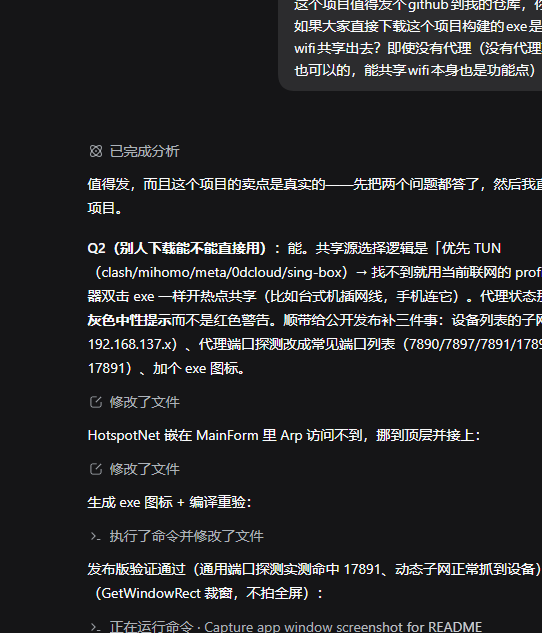

# Proxy Hotspot Share · 共享代理

[](#) [](#) [](#)

> 一键把（代理）网络共享成 WiFi 热点 —— 单文件、零依赖、免安装的 Windows 小工具。

**English in short:** a tiny (~55 KB) single-file Windows utility that shares your internet connection (with **TUN-mode proxy preferred**) as a WiFi hotspot. Double-click → sharing starts. Tray-resident, auto keep-alive, live device list, live proxy status. No proxy installed? It still shares your normal connection and marks proxy status in gray. .NET Framework 4.x (in-box on Win10/11), built with the in-box C# compiler — nothing to install.



## 为什么需要它

- 你在电脑上跑 Clash / mihomo / sing-box（TUN 模式），想让手机**免配置直接走代理**——连上这个热点就行，流量经 ICS NAT 全部进入 TUN 隧道
- Windows 自带的「移动热点」会**在没有设备 5 分钟后自动关闭**、没有设备列表、没有掉线重开；用 `netsh wlan start hostednetwork`？新驱动普遍不再支持 hosted network，这条路已经死了
- 现成工具要么几十 MB、要么收费、要么内核服务常驻。这个 55 KB 单 exe，用系统自带 .NET 运行，关掉就干净

## 功能

| 功能 | 说明 |
|---|---|
| 双击即共享 | 启动自动开启热点；共享源**优先绑定 TUN 代理网卡**（Clash/mihomo/sing-box/0dcloud 等），无代理则共享当前联网连接 |
| 一键开关 | 窗口按钮 / 托盘右键，均可 |
| 热点名/密码 | 随时修改，运行中保存即自动重启热点生效 |
| 网络状态 | 上游 WiFi（SSID/信号/IP）、代理 TUN 网卡状态、系统代理、本地核心端口探活（7890/7897/7891/17891…） |
| 实时吞吐 | TUN 网卡上下行速率与累计流量 |
| 设备列表 | 连接热点的设备 IP + MAC（ARP 实时扫描，子网自适应），设备接入气泡通知 |
| 托盘常驻 | 点 X 只隐藏不退出（热点与保活继续）；再双击 exe 直接唤出窗口 |
| 掉线自动重开 | 专治 Windows「无设备 5 分钟自动关闭热点」 |
| 开机自启 | 当前用户注册表 Run 键，不需要管理员 |

## 下载使用

1. 到 [Releases](../../releases) 下载 `ProxyHotspotShare.exe`（单文件）
2. 双击运行 → 自动开始共享
3. 手机连热点（名称/密码见界面），流量即走代理（若电脑在跑 TUN 代理）

> Windows SmartScreen 可能提示「未知发布者」——点「仍要运行」即可（未签名二进制的正常提示）。
> 程序同目录的 `share.log` 是运行日志，出问题时把它带上提 issue。

## 没装代理也能用吗？

能。热点共享本身就是功能：共享源选择逻辑是 *优先 TUN 代理 → 回退当前联网连接*。没检测到代理时，界面以**灰色**标注「未检测到代理（将共享直连网络）」，热点照常工作——台式机插网线给手机发 WiFi 的场景完全适用。

## 技术要点（值得一看）

- **零依赖单 exe**：.NET Framework 4.x（Win10/11 内置）+ WinForms，55 KB
- **WinRT 完全运行时加载**：控制 Windows 移动热点的 `NetworkOperatorTetheringManager` 属 WinRT API；本项目不引用任何 winmd，全部通过 `Type.GetType("..., ContentType=WindowsRuntime")` + `dynamic` + 反射调用 `WindowsRuntimeSystemExtensions.AsTask` 在运行时驱动——躲开了「机器上没有聚合 Windows.winmd / 没有 facade 程序集 / 老编译器不支持」的三连坑
- **设备识别**：`GetIpNetTable` P/Invoke 原始 ARP 表（注意：探测缓冲区大小时 API 按设计返回 122，别当失败）+ 子网广播 ping 促活 + 热点子网动态自适应
- **编译无需 SDK**：`build.ps1` 直接调 `C:\Windows\Microsoft.NET\Framework64\v4.0.30319\csc.exe`（C# 5.0 语法，代码有意保持兼容），装了 Windows 就能构建

## 从源码构建

```
git clone https://github.com/NormanFxxkingRockwell/share-proxy.git
cd share-proxy
powershell -ExecutionPolicy Bypass -File build.ps1
```

产出 `share.exe`（改个名字就能用）。

## 已知限制

- Windows 移动热点要求本机有可用的 WLAN 网卡（有线网 → 热点没问题；无线 → 需网卡支持同一频段并发）
- 设备列表依赖 ARP 表：设备连接后产生流量才会出现在列表（通常秒级）
- 界面为中文；如需多语言欢迎 PR

## License

[MIT](LICENSE)
